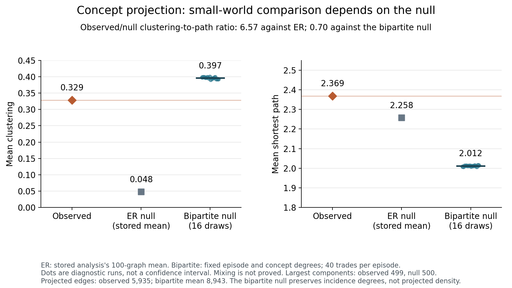

# Network and memory audit

Checked 2026-10-15. Originals were read-only; no pipelines were repaired, no paid
APIs were called, and no raw conversation text or private identifiers are emitted.
This is a targeted audit, not a complete replication of the research program.

The strongest new result is a failure of specificity: the hierarchy paper's
small-world comparison changes from **6.57 against an Erdős–Rényi null to about
0.70 against a null preserving both episode and concept degrees**. The original
ER calculation reproduces as a description of that baseline; it does not establish
exceptional clustering beyond the construction of the bipartite projection.
Temporal growth also requires narrower interpretation, and the previously found
community-tracker and “recency” problems remain unchanged. None of the proposed
network/memory follow-ups is currently a validated, independent ISCS contribution.

## What exists and what overlaps

| Work | Evidence/status inspected | Reuse and present boundary |
|---|---|---|
| Knowledge networks | Published Complex Networks 2025 proceedings; local Springer volume contains the chapter, pp. 315ff. [README](../../../../papers/knowledge-networks/README.md), [manuscript](../../../../papers/knowledge-networks/paper/paper.tex) | Original static analysis and parameter sweep; the later temporal and hierarchy papers use the same 1,908-conversation archive. The 449-node published giant component and the later 453-node cached giant component are different artifact versions, not independent samples. |
| Temporal networks | Current canonical [PLOS source](../../../../papers/temporal-networks/paper/PLOS/paper.tex) has the revised geometry-versus-order framing. Local status remains rejected 2026-04-27, seeking venue. | One original archive plus ten selected WildChat-linked archives. Endpoint geometry is reused. A repaired/expanded analysis belongs primarily to this manuscript; rebranding it as a new independent paper would not create new evidence. |
| Hierarchical memory | [ISCS 2026 program](https://iutdijon.u-bourgogne.fr/ccs-france/wp-content/uploads/2026/05/PROGRAM-ISCS-2026-V2.pdf) was already verified in EVIDENCE.md; [author page](https://metafunctor.com/publications/agentic-memory/) currently says accepted. Current [paper](../../../../papers/hierarchical-memory/paper/paper.tex) is the ChatGPT concept hierarchy. | Accepted/presented lineage; a separately published proceedings chapter was not verified here. The child CLAUDE.md is stale and describes Claude Code delegation experiments instead. The concept analysis uses the same original 1,908 conversations. |
| Selective forgetting | Completed, reviewed diagnostic pilot; [REPORT](../../../../papers/selective-forgetting/REPORT.md), [REVIEW](../../../../papers/selective-forgetting/REVIEW.md), [LITERATURE](../../../../papers/selective-forgetting/LITERATURE.md). | Public LongMemEval and synthetic worlds, not the private CMRI corpus. Existing stop/narrow decision is justified; no reader run is missing under its stopping rule. |
| Percolation / turn taking | [Percolation idea](../../../../future-ideas/percolation-thresholds.md), [motif idea](../../../../future-ideas/turn-taking-motifs.md). | Proposals, not experiments. Their asserted mechanisms are unverified. |
| COMPSAC synthesis | [Outline](../../../../future-ideas/compsac-2026/OUTLINE.md) and [draft](../../../../future-ideas/compsac-2026/paper/paper.tex). No completed submission/publication evidence inspected. | Combines the same static, temporal, and hierarchy results. Repeats superseded growth and merge/split claims; not three independent replications. The outline's venue and the draft's journal header also differ. |

All local source hashes and child repository commits are in
[results.json](../checks/networks/results.json). The prior temporal audit's seven
source/data hashes still match exactly. Its synthetic failures and 10,000-shuffle
summaries are reused, not newly rerun.

## Published static network: real result, overstated validation

The saved 63-configuration table does put the 2:1 weighting and threshold .9 at
the largest recorded modularity, **Q=.749924**; the next is 4:1 at **.745174**.
This checks the optimization statement for this grid, corpus, and saved
partitions. It does not validate “user intent primacy,” semantic truth, learning,
or an optimal configuration for another archive. Modularity is both a selection
criterion and a reported success metric, without a separately held-out semantic
criterion in this audit. [Stored-table inspection](../checks/networks/stored-ablation-inspection.json).

Threshold labels also need literal interpretation. At 2:1, the table contains
giant-component sizes 1,132, 833, 453, 59 for thresholds .85, .875, .9, .925.
Its reported giant fractions divide by **positive-degree nodes**, which also
change (1,210, 934, 601, 284), not by all 1,908 conversations. This is a useful
fragmentation curve, but neither a finite-size scaling experiment nor an
identified critical point. A cosine-threshold difference of .025 is not a
validated “2.5% semantic distance.”

Communities, centrality, and visually identified bridges are descriptive
properties of an embedding-derived graph. Labels such as knowledge, cognitive
structure, integration, and transfer need behavioral validation; co-occurrence or
cosine proximity alone does not show that a person knows, learned, transferred,
or remembered the associated material. The published case study remains a
reasonable visualization/application contribution under that narrower reading.

## Temporal network: current evidence and measurement limits

The current code and manuscript still contain the issues demonstrated in
[EVIDENCE.md](../../EVIDENCE.md):

* **Densification:** observed γ=1.4050, conditional-null mean 1.3480, central 95%
  interval [1.2537, 1.4633], stored p=.2682. All eleven archive rows have γ p>.05.
  This is compatibility with a particular shuffle, not proof that order has no
  effect or that geometry is the causal explanation.
* **Attachment:** observed β=.7632, null mean .8798, interval [.7803,.9781], p=.0242.
  The unadjusted departure is exploratory among several statistics and archives.
  It does not by itself identify an exploration strategy.
* **Community events:** the actual tracker assigns mutual-best continuations
  before merges/splits and excludes assigned communities from later branches.
  Two equal disjoint communities merging into their union yield a continuation,
  not a merge; the reverse yields continuation plus birth. Thus “no observed
  merges/splits,” including under the same shuffled pipeline, cannot support a
  non-recombination law. Real event counts remain unknown.
* **Revisit versus recency:** the index averages maximum cosine similarity to
  any previous conversation. It has no lag term. Immediate and delayed topic
  repetitions can have identical values. The saved ten-archive correlation with
  z(β), ρ=−.7356, p=.0153, reproduces numerically but does not establish a
  recent-return versus old-hub axis. The source's predicted sign is also the
  opposite of this observed revisit correlation.

For a fixed graph with N vertices, m edges and degrees d_i, uniform revelation of
k vertices gives the elementary finite-population identities

\[
E[M_k]=m\frac{k(k-1)}{N(N-1)},\qquad
E[A_k]=\frac{k}{N}\sum_i\left[1-\frac{\binom{N-1-d_i}{k-1}}
{\binom{N-1}{k-1}}\right],
\]

where A_k counts positive-degree revealed vertices and impossible binomial
coefficients are zero. The first follows by edge-endpoint inclusion; the second
conditions on including vertex i and subtracts the probability that none of its
neighbors is included. These are **expectations, not a formula for the expected
OLS slope**. They show why the code's active-node denominator can produce a
non-quadratic edge–node relation under uniform revelation. Fitting nested
cumulative snapshots also does not make their OLS errors independent.

Endpoint graph properties are fixed by this null. Algorithmic partition/path
variation must not be misread as an order effect. Hashed IP/request metadata do
not certify individual identity; the sample is selected for persistent activity.
Whole-conversation embeddings are dated by conversation creation, so an online
interpretation additionally needs a completion/message-time audit. That potential
within-conversation look-ahead was not quantified here.

The viable methodological contribution would be calibrated inference for this
particular observation process, not invention of temporal randomization, which
has a substantial prior literature. See [focused sources](../literature/networks-memory.md).

## Hierarchy: reproduced quantities and newly exposed failures

The numeric incidence reconstruction matches **1,908 episodes, 3,517 raw concept
members, 500 meta-concepts and 7,153 bipartite edges**, with no unmapped mentions.
Its projection has 5,935 edges and a 499-node giant component plus one isolate.
The 500/50/8 hierarchy is imposed by Ward cuts; the paper explicitly reports no
natural silhouette optimum. Finding a hierarchy after hierarchical clustering is
not an independent test that a natural hierarchy exists.

**Ordering and Heaps' law.** The headline β=.3198 and both original null tests
use episodes in alphabetical identifier order. The saved order is indeed
lexicographic, and the independent recomputation gives .319843. The paper's
“robustness to ordering” sentence is too strong: random-order β is about .2405,
well separated from .3198. However, a separate saved experiment gives chronological
.3279, reverse chronological .3045, and shuffled mean .2482±.008. That separate
summary was not rerun; it prevents the simplistic conclusion that chronology
necessarily removes the departure.

For incidence frequency f_c across N episodes, the exact random-order expected
vocabulary is

\[
E[V(k)] = \sum_c\left[1-\frac{\binom{N-f_c}{k}}{\binom Nk}\right].
\]

This follows from the probability of encountering each concept at least once,
regardless of inter-concept co-occurrence. Fitting the paper's nonlinear power
curve to that exact expected curve gives **.239705**. This is not the mean of
fitted exponents. It shows that substantial sublinear growth follows from finite
incidence frequencies without a consolidation process. The original iid episode
bootstrap also randomizes sequence and produces [.2293,.2635] around .2461; it
is not a confidence interval for a chronological .32 estimand.

Both original nulls destroy structured topical associations or their position in
the chosen order; rejecting them does not uniquely establish meaningful categories,
CLS, learning, or consolidation. The standard power curve is unbounded but the
retrospectively chosen vocabulary is bounded by k; fit-range and granularity
effects therefore need to be assessed explicitly. Defining categories from the
whole archive also uses future information if the interpretation is online memory.

**Small-world comparison.** The preread protocol, 9 invariant tests, code and
all 32 recorded checkpoints are in [checks/networks](../checks/networks/README.md).
Each of 16 independent seeds randomizes the same binary incidence graph with
uniform Curveball trades. Every row and column degree is checked exactly.

| Quantity, on largest projected component | Observed | Stored ER mean, 100 graphs | Bipartite null mean, 10 sweeps | Bipartite null mean, 40 sweeps |
|---|---:|---:|---:|---:|
| Mean clustering | .3287 | .0477 | .3969 | .3965 |
| Mean path length | 2.3688 | 2.2581 | 2.0144 | 2.0118 |
| Observed/null clustering-to-path ratio | — | 6.57 | .7044 | .7041 |
| Projected edges | 5,935 | 5,935 by design | 8,948 mean | 8,943 mean |
| Largest component vertices | 499 | 499 by design | 500 | 500 |

At 40 sweeps, all 16 null clustering values lie between .3907 and .4004, above
the observed .3287. The two checkpoints are descriptively consistent. **There is
no mixing proof, confidence interval, or formal p-value claim from these 16
diagnostic draws.** This null preserves incidence degrees, not projected edge
count, and hence tests a different question from ER. It retains the clique
formation and frequency heterogeneity inherent to episode projection. The result
undermines the inference that ER-relative clustering is special evidence of
memory-like organization. It does not establish absence of semantic structure:
repeated specific associations and greater compartmentalization can produce fewer
distinct projected edges than this null. A full paper would examine that residual
structure explicitly rather than calling the archive random.

**“Flow” and porosity.** The saved porosity is the *mean of seven incoming
domain fractions*, whereas the manuscript defines it as the proportion of episodes
having **any** foreign concept. For ML & Network Science the mean is .29884;
one incoming domain alone overlaps .52973 of its episodes, so the union cannot
be .30. A separate stored `import_rate` is .97838, but its generator was not found
and that union was not independently reconstructed. Broadcast reach is similarly
an unweighted row mean, not the pooled share of all other-domain episodes
(Software Engineering: .4040 versus .3951). [Aggregate check](../checks/networks/stored-flow-inspection.json).
Neither asymmetric conditional incidence nor its size-normalized version measures
temporal or causal transfer.

**Reproducibility.** The available extraction state does not record the API model,
temperature, request hashes or complete extraction provenance. The general
formatter also has a 4,000-character total cap beyond the paper's first-20-messages,
500-characters-each description. The separate executable batch script targets an
older llama3.2 run, not a reproducible entry point for the stated parallel Claude
extraction. These facts leave model/run provenance unverified; they do not prove
which model generated the saved outputs. The current hierarchy test command has
nine collection errors from old `agentic` imports. The directly relevant three
suites pass 48 tests, with 62% coverage over their modules; the paper's null and
flow figure scripts are outside that coverage.

## Selective forgetting: retain the negative result

The completed pilot already found no stable marginal value of participation
beyond nuisance controls and shuffled scores. Diversity and bridge policies both
retain complete annotated benchmark support in 0/33 eligible cases at both
budgets/all tested k. The primary k=10 bridge-minus-shuffled recall differences
are −.20 points [−3.60,2.77] and +.51 [−4.54,5.80]. All annotated support sets
could fit, so failure is not a mathematically impossible cap.

The synthetic generator supplies a ceiling: diversity, rarity, bridge and shuffled
bridge all retain all necessary facts. At k=10 all planted support records have
participation zero, including the “cross-topic” wording. No clearly cross-topic
benchmark question was identified in the fixed evaluation sample. Thus neither
the generator nor the benchmark supports the intended bridge mechanism. Gold-turn
retention is also not validated minimal sufficient support or answer accuracy.
These are affirmative reasons to stop this hypothesis, not missing reader work.

Existing 33-test/73%-coverage verification, 92/92 replay hashes and the successful
115-second reproduction are evidence recorded by the completed pilot; none was
rerun or recertified here. Repeating the same benchmark with a larger reader or
tuning the generator until bridge wins would not resolve the measurement problem.
Generic graph-memory forgetting is additionally preempted by the 2026 literature.

## Future ideas and ranking

1. **Conditional network-measurement study — strongest, but requires a new
   discriminating contribution.** Calibrated revelation baselines and validated
   temporal measurements could support revision of the temporal paper. A separate
   submission needs independent data/analysis and explicit overlap disclosure.
2. **Projection-aware hierarchy audit — worthwhile diagnostic, not yet a new
   memory theory.** The new null reversal justifies a multi-corpus comparison of
   construction effects and residual associations. It does not justify rerunning
   a generic “hierarchical semantic memory exists” study.
3. **Selective forgetting — narrow/stop.** Preserve the negative pilot. A future
   study first needs independently annotated necessary cross-topic facts and a
   verified structural bridge contrast, with nuisance-matched and shuffled-score
   controls. This would be a new measurement study, not a continuation by tuning.
4. **Percolation — reject the universality claim as currently formulated.** A
   denser threshold sweep of one archive is not finite-size scaling. Increasing
   θ removes edges, so the connected-side order parameter would use θ_c−θ, not
   θ−θ_c. No correlation-length definition, size family, finite-size window or
   scaling collapse is specified. Random-graph finite-size scaling cannot simply
   inherit a lattice ν. Semantic threshold-resilience curves already exist in
   prior work. A narrower threshold-stability diagnostic might be useful.
5. **Role-only turn motifs — reject the proposed representation.** If vertices
   are messages with adjacent transitions, every uncolored k-window is the same
   directed path. With strict user/assistant alternation there are at most two
   role-colored windows, fixed by parity; conditional role entropy is zero.
   If vertices are roles, the graph collapses to two vertices. Synthetic checks
   for lengths 2–20 confirm these facts. An ER baseline would primarily detect
   the interface's alternation constraint. Richer acts, repairs, tool events or
   branching could define a different question but require validated coding and
   length/protocol-preserving nulls.
6. **COMPSAC synthesis — no independent contribution in its present form.** It
   recycles the same three analyses and obsolete claims. It should not be counted
   as a new empirical confirmation or submitted without a new research question.

### Precise next experiment for the highest-ranked direction

Before another empirical paper run, freeze a calibration benchmark with **50
independent fixed geometric endpoint graphs** (N=400; isotropic versus separated
topic mixtures), each revealed under uniform order and three known topic-persistence
levels. Fix the embedding/edge rule and all-node versus active-node denominators
before outcomes. Measure (i) exact edge/active-node expectation agreement under
uniform revelation, (ii) type-I error and power of a timestamp-shuffle test, and
(iii) a directly defined return lag, with ties and the observation horizon handled
explicitly. Use known lag-positive controls and fixed-endpoint counterexamples.
Community lifecycle measurements should first pass hand-checkable pure
merge/split/continuation/birth/death fixtures, then planted noisy transitions;
these are separate measurement gates, not outcomes to optimize.

Continue to public archives only if the diagnostics are calibrated and detect the
planted alternatives. Use archive-level uncertainty, report all selected archives,
condition on unequal lengths/activity, and avoid treating pseudonymous linkage as
verified people. The narrow question is whether any order statistic carries stable
information beyond the specified construction nulls; a negative answer is a valid
stop decision. This experiment is proposed, not executed in this audit.
