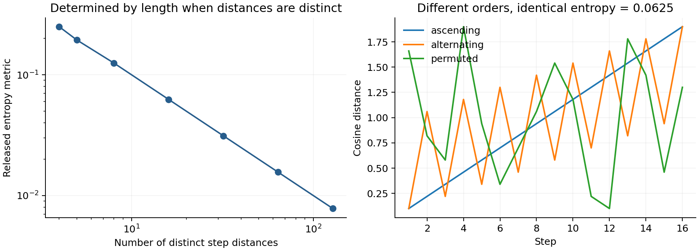

# Median-split entropy audit

This independent implementation checks the exact formula identified in [PROTOCOL.md](PROTOCOL.md). It does not vendor or execute the upstream repository. The primary formula and public source file were inspected and pinned by commit/SHA256.

For n distinct step distances and the released strict-median comparison, p=floor(n/2)/n and the metric is h2(p)/n. For even n this is 1/n. Sorting or otherwise permuting those distances does not change p. Ties can change p. The version without division by n also contains no order information.

The reproducible check found zero floating-point error against the closed form over 700 continuous random examples. Three valid unit-vector paths realizing different orders of the same 16 distances give the identical metric .0625, while their descriptive lag-1 correlations are 1, -.5 and -.07389. This is a mathematical/implementation illustration, not a claim about frequencies or effect sizes in the published datasets. No confidence interval applies to the exact identity.



From this directory:

```bash
/home/spinoza/github/cmri/papers/selective-forgetting/.venv/bin/python audit.py
/home/spinoza/github/cmri/papers/selective-forgetting/.venv/bin/python -m pytest -q --cov=. --cov-report=term-missing --cov-report=json:coverage.json test_audit.py
```

The reused environment is pinned by `papers/selective-forgetting/requirements.lock`; runtime and direct dependency versions are in [runtime.json](runtime.json). The standalone check took approximately 1.05 seconds in the recorded run. All nine tests passed; implementation statement coverage is 99% (only the CLI guard's call is outside the test measurement; it was separately executed). Both PNG and SVG are generated; the PNG was visually inspected.

Development evidence: tests first failed because the implementation was absent. The first default-interpreter integration run failed because Matplotlib is not installed in that interpreter; switching to the already-existing pinned environment resolved this without installing dependencies. A test for complete artifacts then failed on the missing output-directory interface, which was implemented. The first coverage invocation named a module loaded under another name and collected no data; using the source directory produced the valid report. These failures did not change the mathematical prediction.

Interpretation: this particular marginal-entropy statistic cannot substantiate temporal unpredictability. The other metrics and empirical findings in its source paper require their own assessments. This gives a concrete external example for a possible CMRI calibration study, not permission to dismiss a whole research area.

Final source check (2026-10-15): the [April v2 methods](https://arxiv.org/html/2602.05971v2) retain the median split. The prose specifies division by step count while displayed Eq. 2 gives unscaled H; Eq. 1 uses `>=`, unlike the pinned code's strict `>`. For distinct distances the complementary odd-length proportions have the same binary entropy, so neither difference rescues the order interpretation. This is a critique of the pinned formula, not a reproduction of clinical/group results. The independent reviewer also checked the pinned source directly.
